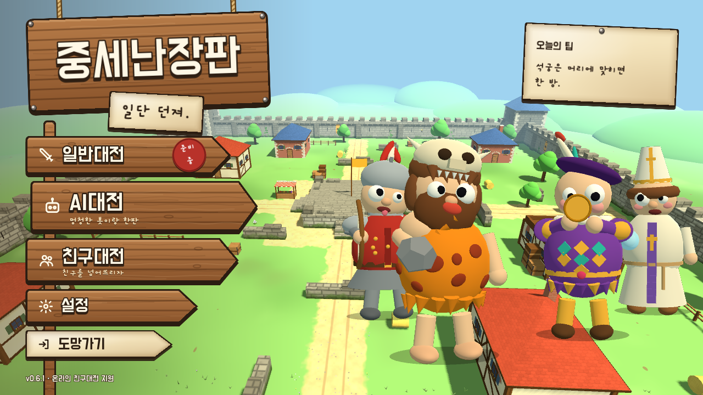
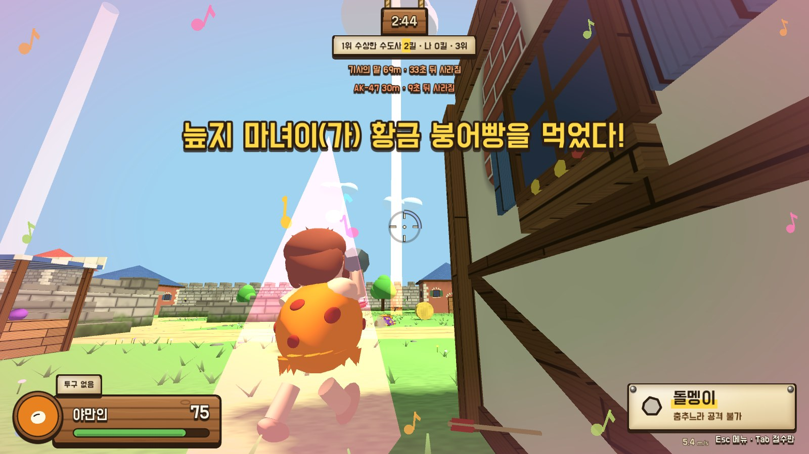
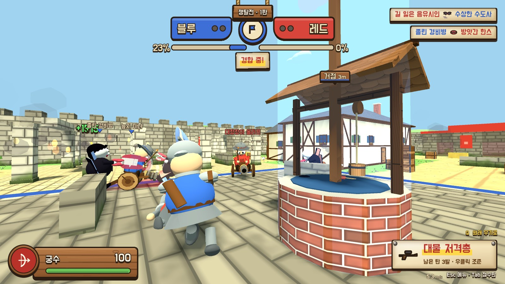
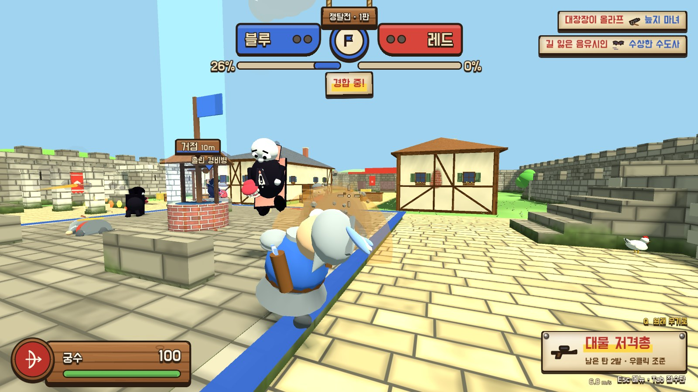

# 중세난장판

> 일단 던져.

중세풍 **병맛 FPS**입니다. 흐물흐물한 야만인·궁수·성직자·흡혈귀들이 돌멩이, 화살, 성수, 트럼펫, 틀니, 대포를 들고 싸웁니다.
급하게 돌면 넘어지고, 점프하고 내려오다 넘어지고, 활을 너무 오래 당기면 손이 미끄러지고, 가끔 하늘에서 AK-47이 떨어집니다.
이기는 것도 좋지만 **친구를 닭으로 넘어뜨리는 게 더 중요합니다.**

Three.js로 만든 HTML 프로토타입을 **Godot 4.7**로 옮긴 프로젝트입니다. 웹 브라우저와 Windows에서 돌아갑니다.

**▶ 바로 하기: https://jungse-nanjangpan.vercel.app** (PC 브라우저, 설치 없음. 친구대전도 이 주소에서)

**▶ Windows 버전 받기: [최신 릴리스 (v0.6.1)](https://github.com/apply2/craft-on-team-DaeGamDack/releases/latest)**: zip을 풀고 `jungse-nanjangpan.exe` 실행



**개인전**: 음유시인 트럼펫에 걸려 춤추는 야만인. 춤추는 동안은 공격을 못 합니다.



**쟁탈전 5:5**: 우물 거점을 두고 경합 중. 흡혈귀는 물고, 포병은 대포를 겨눕니다.



**쟁탈전 5:5**: 거점 앞으로 박쥐 돌진하는 흡혈귀.



---

## 누가 나갈래? 병과 7개

| 병과 | 무기 | 체력 | 한마디 |
|---|---|---|---|
| 야만인 | 돌멩이 | 90 | 생각 없음. 돌 있음. |
| 궁수 | 활 | 100 | 당기다 손 미끄러짐 주의. |
| 석궁병 | 석궁 | 110 | 한 발이면 끝. 휠로 감아라. |
| 성직자 | 성수 | 100 | 성수 맛 좀 봐라. |
| 음유시인 | 트럼펫 | 95 | 내 연주에 춤춰라. |
| 흡혈귀 | 틀니 | 130 | 덥다... 피 좀 줘. |
| 포병 | 대포 | 130 | 발밑에 쏘면 난다. |

수치는 개인전 기준입니다. 쟁탈전은 몇몇 병과 수치가 조금 다릅니다 (흡혈귀 체력 150 등).

### 🪨 야만인: 돌멩이
짐승 해골을 뒤집어쓴 원시인. 생각은 안 하고 던집니다.
- 좌클릭을 누르고 있으면 **0.4초마다 돌멩이 연사** (피해 11, 사거리 15m)
- 병과 중 **가장 빠름** (달리면 9m/s). 대신 체력은 가장 낮은 90
- 우클릭 **고기 먹기**: 바로 30 회복하고 춤·둔화·경직을 다 풂 (8.3초마다)
- 💬 *생각하지 마세요. 돌이 먼저 날아가고 생각은 나중에 따라옵니다. 춤추게 됐으면 고기를 뜯으세요. 고기는 모든 걸 해결합니다.*

### 🏹 궁수: 활
빨간 갑옷의 명사수. 본인 생각에는요.
- 누르고 있으면 당기고, 놓으면 쏩니다. **1초면 끝까지** 당겨지고 피해는 15~50
- 짧게 끊어 쏘면 연사, 끝까지 당기면 한 방. 화살은 포물선으로 떨어짐
- 끝까지 당긴 채 1초가 넘으면 팔이 후들거리고, **3초면 손이 미끄러져** 엉뚱한 데로 날아감
- R = 당기기 취소
- 💬 *폼 잡고 너무 오래 조준하지 마세요. 그 화살은 하늘로 갑니다. 진짜로.*

### 🎯 석궁병: 석궁
파란 갑옷의 한 방 장인. 장전은 손으로 직접.
- 피해 75, **머리에 맞히면 한 방**. 거의 직선으로 날아감
- 쏜 뒤엔 **마우스 휠을 아래로 50칸** 굴려야 다시 장전 (쟁탈전은 30칸). 감는 동안 조금 느려짐
- 💬 *빗나가면 휠을 미친 듯이 굴리세요. 손가락 운동도 되고 좋습니다. 맞히면 상대가 휠 굴릴 일은 없습니다.*

### 💧 성직자: 성수
축복을 담아 병째로 던집니다.
- 성수병을 3개까지 모아 던짐 (3초마다 1개 참)
- 깨지면 반경 3m 웅덩이가 3초 동안 남음. 적은 **0.5초마다 8 피해 + 65% 느려짐**, 나는 그 안에서 회복
- 자연 회복이 남들보다 2배 빠름
- 💬 *적이 모인 곳에 던지고 "축복입니다"라고 말해 주세요. 웅덩이에서 버둥대는 모습은 덤입니다.*

### 🎺 음유시인: 트럼펫
중세에 트럼펫? 묻지 마세요. 음악은 시대를 초월합니다.
- 누르고 있으면 연주. 앞쪽 원뿔(12m) 안의 적에게 초당 12 피해
- 원뿔 안에 오래 있던 적은 **2초 동안 춤춥니다**. 춤추는 동안 느리고 **공격을 못 함**
- 우클릭 **팡파레** "빠바밤!": 가까운 적을 날려 보냄 (6초마다)
- 숨은 3초까지. 다 쓰면 헐떡이고, 가끔 **삑사리**가 남
- 💬 *혼자서는 약합니다. 친구가 춤추는 적을 쏠 수 있게 무대를 깔아 주세요. 삑사리도 예술입니다.*

### 🧛 흡혈귀: 틀니
창백한 피부, 올백 머리, 높은 깃 망토. 문제는 **여기가 대낮**이라는 것.
- 햇빛에 **초당 10씩 탑니다**. 자연 회복도 없음. 가만히 있으면 약 15초 만에 바삭하게 구워짐
- 살려면 물어야 합니다: 3m 안의 적을 물면 **20 피해 + 15 회복**, 처치하면 +30
- 우클릭 **박쥐 돌진**: 바라보는 쪽으로 9m를 0.3초에 날아감 (7초마다)
- 💬 *쉬지 마세요. 쉬면 탑니다. 무조건 앞으로, 무조건 목덜미로. 돌진해서 물고 다음 놈에게 또 돌진하세요.*

### 💣 포병: 대포
통나무 바퀴 달린 봄바드에 걸터앉은 탱커. 느리지만 대포가 있습니다.
- 포탄이 터지면 반경 2.5m에 범위 피해, **직격하면 100**
- 쏜 뒤엔 **R을 꾹 눌러** 4초 동안 장전. 우클릭하면 포탄이 떨어질 곳이 보임
- 달리기 없음, 점프도 낮음, 덩치가 커서 잘 맞음. 대신 체력이 130이고 둔화를 절반만 받음
- **발밑에 쏘면 하늘로 날아갑니다** (포탄 점프, 자기 피해는 1/3)
- 💬 *걸어서 가기 느리면 날아가세요. 착지 지점에 적이 있으면 그것도 포탄으로 인사하세요.*

---

## 무엇을 할 수 있나

### 모드
- **AI대전 개인전** — 봇 7명과 4분 동안, 먼저 20킬이면 끝
- **AI대전 쟁탈전 (5:5)** — 가운데 우물 광장 거점을 점령하는 3판 2선승
- **친구대전 (온라인)** — 방 코드 4자리로, 인터넷만 되면 웹·PC 어디서든 (웹과 PC가 섞여도 됨). 개인전·쟁탈전 둘 다, 대기실에서 방장이 봇을 넣고 병과·난이도를 정할 수 있음
- 봇 난이도: 쉬움 / 보통 / 어려움

### 특수 아이템
- **대물 저격총** — 맞으면 즉사, 5발
- **AK-47** — 25발 연사
- **기사의 말 + 마상창** — 7초 동안 타고 달림, 창에 걸리면 멀리 날아감
- **닭** — 잡아서 던지면 맞은 사람이 무조건 넘어짐
- **황금 붕어빵** — 먹으면 8초 무적 + 몸박치기 (BGM이 메탈로 바뀜)

### 이렇게 놀면 더 재밌다
- 🐔 **닭은 무기입니다.** 닭에 맞은 사람은 무조건 넘어집니다. 저격총보다 닭이 더 굴욕적입니다.
- 🐎 **말을 보면 일단 타세요.** 창끝에 걸린 적은 성벽 너머 어딘가로 사라집니다. 7초 뒤엔 말이 도망가니 즐길 수 있을 때 즐기세요.
- 🐟 **황금 붕어빵 냄새가 나면 뛰세요.** 메탈 음악이 나오는 8초 동안은 당신이 이 마을의 주인입니다. 몸으로 박으세요.
- 🌀 **급하게 돌지 마세요.** 달리다 홱 돌면 넘어집니다. 점프하고 내려오다가도 가끔 넘어집니다. 이건 버그가 아니라 중세입니다.
- 🎺 **음유시인 + 석궁병 = 무대와 저격수.** 춤추는 적의 머리는 잘 안 움직입니다.
- 💣 **포병은 날 수 있습니다.** 지붕 위로 올라가려고 하면 미끄러져 내려오니, 그냥 적 머리 위로 날아가세요.
- 🧛 **흡혈귀는 그늘이 없습니다.** 이 마을엔 해가 지지 않습니다. 기다리면 타고, 덤비면 삽니다.
- 🏆 결과 화면에서 "넘어짐 N회"가 크게 나오면 그것도 기록입니다. 자랑하세요.

---

## 조작

| 동작 | 키 |
|---|---|
| 이동 | W A S D |
| 달리기 | 왼쪽 Shift (앞으로 갈 때만) |
| 슬라이드 | 달리다가 Ctrl 또는 C |
| 점프 | Space |
| 공격 | 좌클릭 |
| 조준 / 병과 기술 (야만인 고기 먹기, 음유시인 팡파레, 흡혈귀 박쥐 돌진, 포병 탄도 조준) | 우클릭 |
| 석궁 장전 | 마우스 휠 아래로 |
| 포병 장전 (꾹) · 활 당기기 취소 | R |
| 특수 무기 ↔ 원래 무기 | Q |
| 1인칭 / 3인칭 | V |
| 점수판 | Tab |
| 일시정지 | Esc |
| 명중 판정 디버그 표시 (개발용) | F9 |

---

## 실행하기

### 에디터에서
1. [Godot 4.7](https://godotengine.org/) (Standard 버전, 4.7.2에서 확인)을 받습니다. C#(.NET) 버전은 필요 없습니다.
2. Godot 프로젝트 관리자에서 `project.godot`을 엽니다.
3. F5로 실행하면 메인 메뉴가 뜨고, 뒤에서 봇들이 싸우는 걸 구경할 수 있습니다.

### 웹으로 내보내기
웹 내보내기 템플릿(`web_nothreads_release`)이 깔려 있어야 합니다.

```bash
godot --headless --path . --export-release "Web" export/web/index.html
cd export/web && python -m http.server 8060   # 브라우저로 http://localhost:8060
```

스레드 없는 빌드라 특별한 서버 설정(COOP/COEP) 없이 Vercel·GitHub Pages·itch.io에 그대로 올릴 수 있습니다.

### 웹으로 올리기 (Vercel, 무료)
[Node.js](https://nodejs.org/)가 깔려 있어야 합니다. 처음 한 번은 Vercel 로그인을 물어봅니다.

```bash
npx vercel deploy export/web --prod
```

지금 올라가 있는 주소는 **https://jungse-nanjangpan.vercel.app** 입니다 (Vercel 프로젝트 `jungse-nanjangpan`). 이 주소를 친구에게 보내면 됩니다.
`export/web`이 이 프로젝트에 연결돼 있어서(`export/web/.vercel`) 다시 올려도 같은 주소가 바뀝니다.
처음 받은 저장소라 연결이 없으면 한 번만 `npx vercel link --project jungse-nanjangpan --cwd export/web` 하세요.
연결하면 `export/web/.env.local`(접속 토큰)이 생기는데, 사이트에 같이 올라가지 않게 **올리기 전에 지우세요**.

### 친구대전이 돌아가는 방식
- 게임 데이터는 **방장 ↔ 친구가 WebRTC로 직접** 주고받습니다. 게임 서버를 따로 띄우지 않습니다.
- 처음에 서로를 찾을 때만 **Supabase Realtime**(무료)으로 짧은 연결 정보를 주고받습니다. 주소와 공개 키는 `scripts/game_data.gd`의 `NET.supabase_url`·`supabase_key`에 있습니다.
- 학교·회사 와이파이처럼 막힌 망에서는 직접 연결이 안 될 수 있습니다. 그럴 땐 휴대폰 핫스팟 같은 다른 인터넷으로 해 보세요.
- 방장이 나가면 방이 닫힙니다.

### Windows exe로 내보내기

```bash
godot --headless --path . --export-release "Windows" "export/windows/중세난장판.exe"
```

exe에 게임 데이터가 다 들어 있습니다. 옆에 같이 나오는 `libwebrtc_native.windows.template_release.x86_64.dll`(친구대전용)과 **함께** zip으로 묶어서 주세요.
- 처음 실행할 때 Windows SmartScreen이 막으면 "추가 정보 → 실행"을 누릅니다 (코드 서명을 안 해서).
- 방화벽이 물어보면 허용을 눌러 주세요.

---

## 자동 테스트

이동·전투·봇·UI 규칙을 헤드리스로 확인하는 테스트가 `tests/`에 있습니다. 모두 `ALL PASS`가 나와야 합니다.

```bash
# 스크립트 오류 확인
godot --headless --path . --quit-after 120

# 예: 석궁 테스트
godot --headless --fixed-fps 60 --path . -s tests/test_crossbow.gd
```

전체 목록과 성능 측정 도구(`tests/perf_*.gd`, 화면 필요)는 [CLAUDE.md](CLAUDE.md)의 "테스트 실행"에 있습니다.

---

## 폴더 구조

```
project.godot          프로젝트 설정 (렌더러 Compatibility, 물리 Jolt 60Hz)
scenes/                main.tscn (게임 전체), player.tscn (캐릭터)
scripts/game_data.gd   ★ 모든 수치·병과·무기·색. 밸런스는 이 파일만 고치면 됨
scripts/               전투(combat), 캐릭터(player·derp_model), 봇(bot_ai), 맵(world_builder·maps/),
                       아이템(items), 친구대전(net·net_signal), HUD·메뉴(hud·menu·ui_kit·ui/), 소리(sfx·music)
shaders/               맵 무늬 (벽돌·판자·기와·잔디 …)
audio/                 배경음악·효과음
fonts/                 도현·개구·Noto (모두 OFL)
addons/webrtc_native/  PC 버전 친구대전용 WebRTC (웹은 브라우저 것을 씀)
tests/                 자동 테스트 · 사진 찍는 스크립트 · 성능 측정
reference/             원본 HTML 프로토타입, UI 시안
```

개발 규칙·게임 규칙 명세·설계 메모는 [CLAUDE.md](CLAUDE.md)에 자세히 적혀 있습니다.

---

## 만든 방법

- 엔진: Godot 4.7, **GDScript만** (웹으로 내보내려고 C#은 안 씀)
- 그래픽: 외부 3D 모델 없이 **기본 도형 조합**으로 만든 흐물흐물 캐릭터와 마을, 무늬는 셰이더로 그림
- UI: "마을 게시판" 스타일 — 나무판·양피지·금칠, 쇠못과 밧줄

## 라이선스 · 출처

- 글꼴: [도현](https://fonts.google.com/specimen/Do+Hyeon), [개구](https://fonts.google.com/specimen/Gaegu), Noto Sans — 모두 SIL Open Font License (`fonts/OFL*.txt`)
- 효과음: 직접 만든 소리 (`audio/sfx/`)
- PC 친구대전 WebRTC: [godotengine/webrtc-native](https://github.com/godotengine/webrtc-native) 1.2.2 — MIT (`addons/webrtc_native/LICENSE.*`)
